<picture>
  <source media="(prefers-color-scheme: dark)" srcset="./banner-dark.svg">
  
</picture>

I build software where it meets the physical world.

- Founder of **[Pajuniitty Technologies](https://pajuniitty.com)**, doing computer vision, software and technical consulting
- High school student in Turku

### Competitions & events

  
  
  
  
  
  
  
  
  

### Things I work on

- **Polygon packing**: world-record packings on Erich Friedman's Packing Center
- **Stellarator research**: Lean-verified certificates for stellarator (W7-X) magnetic fields
- **Kerr path tracer**: GPU (Vulkan) path tracer for rotating black hole spacetimes
- **PCB autorouter**: autonomous placement and routing for circuit boards

Too many projects, most of them private for now.
